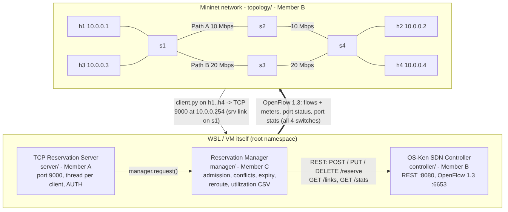
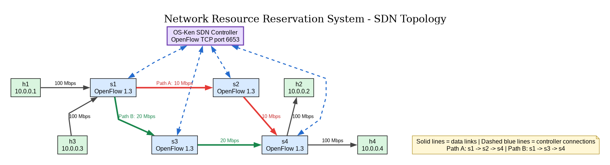

# Network Resource Reservation System

Users book guaranteed bandwidth between two hosts for a fixed time over a TCP protocol. A reservation manager admits or rejects each request, and an SDN controller enforces every accepted booking in the switches with OpenFlow 1.3 rules and meters.

A booked 5 Mbps flow kept **4.6 Mbps** while another host flooded the same link with 30 Mbps. Without the system, the same flow fell to **0.26 Mbps**.

| Member | Part | Code |
|---|---|---|
| A | TCP server, protocol, client | `server/`, `client/` |
| B | SDN controller, Mininet network | `controller/`, `topology/` |
| C | Reservation manager, integration, evaluation, demo + web UI | `manager/`, `evaluation/`, `demo/`, `ui/` |

## Requirements covered

| Requirement | How | Where |
|---|---|---|
| TCP reservation protocol | text protocol on port 9000: `AUTH`, then `REQUEST` / `STATUS` / `LIST` / `CANCEL` | `server/` |
| Concurrent requests | one thread per client + one lock in the manager | `server/reservation_server.py`, `manager/reservation_manager.py` |
| Resource information | capacity and booked Mbps per link and direction, plus a booking table | `manager/reservation_manager.py` |
| Conflict detection | `CONFLICT`, `NO_CAPACITY`, `INVALID`, `UNAUTHORIZED`; falls back to Path B | `manager/reservation_manager.py` |
| SDN policies | OpenFlow 1.3 rules on every switch of the path + a meter on the first switch | `controller/sdn_controller.py` |
| Reservation expiry | timer every 0.5 s frees the bandwidth and deletes the rules | `manager/reservation_manager.py` |
| Utilization tracking | booked and measured Mbps per link, written every second | `manager/utilization_tracker.py` |
| Evaluation | every request logged; 5 experiments against a baseline | `evaluation/`, `results/` |

## Architecture



1. A client on a Mininet host sends `REQUEST user1 10.0.0.1 10.0.0.2 5 300` over TCP to the server (10.0.0.254:9000).
2. The server checks the login and passes the request to the reservation manager.
3. The manager checks: valid request → same pair not already booked → a path where every link has room (Path A, then Path B). Under one lock it books the bandwidth, then asks the controller (REST, port 8080) to install the rules. If that fails, the booking is undone.
4. The controller installs a priority-100 rule on every switch of the path, a meter (speed limit) on the first switch, and a priority-90 rule for replies. The cookie is the booking id.
5. Expiry, cancel or a broken link frees the bandwidth and removes or moves the rules.

## Topology



- h1, h3 on s1; h2, h4 on s4; host links 100 Mbps.
- **Path A** s1–s2–s4: 10 Mbps. **Path B** s1–s3–s4: 20 Mbps.
- `srv` (10.0.0.254) is the laptop itself plugged into s1, so the hosts can reach the TCP server.
- Everything is described once in `config/topology.json`.

## Policies

- **Admission:** accept only if every link on the path has the Mbps free, in that direction (links are full duplex).
- **Meters:** each booking gets a meter at its first switch. Every core port also has a best-effort meter = capacity − booked, so traffic without a booking cannot take booked bandwidth.
- **Expiry and cancel:** bandwidth is freed, and rules + meter are deleted by cookie.
- **Link failure:** the switch reports it, the manager moves affected bookings to a path with room, or marks them FAILED.
- **Access:** token per user; users can only see and cancel their own bookings.
- **Baseline mode** (`NRRS_BASELINE=1`): accepts everything and installs no meters, for comparison.

## Protocol (TCP port 9000)

| Client sends | Server replies |
|---|---|
| `AUTH user1 demo-token-user1` | `AUTH_OK` or `REJECT UNAUTHORIZED` |
| `REQUEST user1 10.0.0.1 10.0.0.2 5 300` | `ACCEPT 1 h1-s1-s2-s4-h2 <end time>` or `REJECT <reason>` |
| `STATUS 1` | `STATUS ACTIVE 1 5.0 <end time> h1-s1-s2-s4-h2` (or EXPIRED / CANCELLED / FAILED) |
| `LIST user1` | `LIST 1,3` or `LIST NONE` |
| `CANCEL 1` | `OK` or `ERROR NOT_FOUND / NOT_ACTIVE / UNAUTHORIZED` |

Reject reasons: `NO_CAPACITY`, `CONFLICT`, `INVALID`, `UNAUTHORIZED`, `CONTROLLER_ERROR`.

## Project structure

```
CN_PROJECT_FINAL/
├── demo.sh                      one-command terminal demo (13 steps)
├── ui.sh                        web interface with a 3D view of the network
├── client/client.py             client: one command or a menu
├── config/                      topology.json + helper used by every part
├── controller/sdn_controller.py OS-Ken controller + REST API
├── topology/sdn_topology.py     Mininet network
├── server/                      TCP server, protocol parser, login
├── manager/                     reservation manager, controller client, link watcher, utilization
├── demo/terminal_demo.py        the steps run by demo.sh
├── ui/                          web page: HTML/CSS/JS + three.js (3D view), served by Python http.server
├── evaluation/                  experiments E1–E5 and graphs
├── tests/                       40 unit/integration tests + load test
├── scripts/                     install, start OVS, run each part
├── results/                     summary.md, CSV tables, graphs/
└── docs/                        architecture and topology diagrams
```

## Prerequisites

- Windows 10/11 with WSL2 + Ubuntu (22.04 or newer), or a normal Ubuntu machine
- Clone or unzip this repo into your Ubuntu home folder as `~/CN_PROJECT_FINAL`

## Setup (once)

```bash
cd ~/CN_PROJECT_FINAL
bash scripts/install_wsl.sh                               # Mininet, Open vSwitch, iperf3 + Python venv at ~/nrrs-env
~/nrrs-env/bin/python -m unittest discover -s tests -v    # 40 tests, no network needed
```

## Run

Run one option at a time. Ctrl+C stops it.

**Option 1: terminal demo (13 steps, Enter = next step)**
```bash
cd ~/CN_PROJECT_FINAL && bash demo.sh
```

**Option 2: web interface with 3D view** (then open http://localhost:8000)
```bash
cd ~/CN_PROJECT_FINAL && bash ui.sh
```

**Option 3: three terminals**
```bash
# terminal 1: controller
cd ~/CN_PROJECT_FINAL && bash scripts/start_ovs.sh && bash scripts/run_controller.sh
# terminal 2: TCP server + manager
cd ~/CN_PROJECT_FINAL && bash scripts/run_server.sh
# terminal 3: network (opens the mininet> prompt)
cd ~/CN_PROJECT_FINAL && bash scripts/run_network.sh
```

At the `mininet>` prompt:
```
pingall
h1 python3 client/client.py --show --host 10.0.0.254 "REQUEST user1 10.0.0.1 10.0.0.2 5 300"
h1 python3 client/client.py --show --host 10.0.0.254 "STATUS 1"
h1 python3 client/client.py --show --host 10.0.0.254 "LIST user1"
sh ovs-ofctl -O OpenFlow13 dump-flows s1 cookie=1/-1
sh ovs-ofctl -O OpenFlow13 dump-meters s1
h2 iperf3 -s -D
h1 iperf3 -c 10.0.0.2 -t 5
link s1 s2 down
h1 python3 client/client.py --show --host 10.0.0.254 "STATUS 1"
link s1 s2 up
h1 python3 client/client.py --show --host 10.0.0.254 "CANCEL 1"
sh python3 tests/load_test.py 50
exit
```
Then Ctrl+C in terminals 2 and 1.

## Experiments

```bash
sudo python3 evaluation/run_all_experiments.py      # about 7 minutes, writes results/raw/
~/nrrs-env/bin/python evaluation/plot_results.py    # graphs + results/summary.md
```

| Exp | Test | Our system | Baseline |
|---|---|---|---|
| E1 | 5 → 40 users, random requests | accepted 60% → 15%, never over 100% of a link | accepted 100%, booked up to 23.5× a link |
| E2 | 5 Mbps booked, 30 Mbps UDP flood | 4.6 Mbps, 1.7% pings lost | 0.26 Mbps, 76.7% pings lost |
| E3 | same load on 10 vs 20 Mbps core links | 72% used, 38 refused vs 53% used, none refused | – |
| E4 | waves of 3 s bookings | 0 bookings and 0 rules left after expiry | – |
| E5 | cut s1–s2 during a booking | moved to Path B in 0.06 s, traffic back in 1.0 s | – |
| Load | 50 clients at once | all answered, 0 errors | – |

Full tables are in `results/summary.md`, graphs in `results/graphs/`.

## Troubleshooting

| Problem | Fix |
|---|---|
| `PermissionError ... logs/server.log` | `sudo chown -R $USER:$USER ~/CN_PROJECT_FINAL` |
| `rm: cannot remove ... Permission denied` | files left by a `sudo` run: use `sudo rm -rf ~/CN_PROJECT_FINAL` |
| REQUEST hangs or `CONTROLLER_ERROR` | the controller (terminal 1) is not running |
| `Address already in use` | stop everything, then `sudo mn -c` |
| `db.sock ... no such file` | `bash scripts/start_ovs.sh` |
| `Error: Warning: sch_htb: quantum ... is big` | harmless warning from the link speed limiter |
